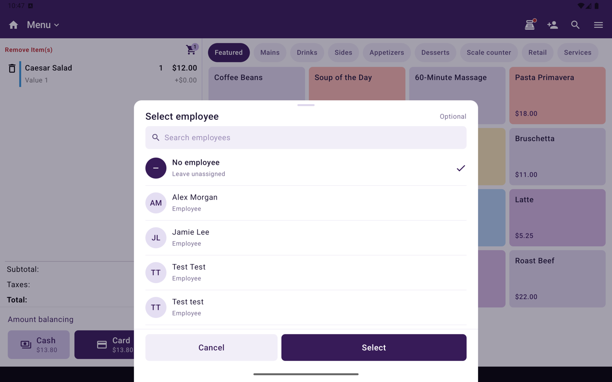

**Helped by** records which employee served the customer on a sale. Use it when the person who helped is not the person at the register, such as a stylist whose client pays at the front desk.

<Frame caption="Select employee for Helped by.">
  
</Frame>

Tips and **Sales by employee** go to the **Helped by** employee instead of the cashier.

## Set Helped by on a sale

<Steps>
  <Step title="Open Order actions">
    In Register, build the order on **Menu** or **Catalog**, then open **Order actions**.
  </Step>
  <Step title="Tap Helped by">
    Under **Adjust**, tap **Helped by**. **Select employee** opens.
  </Step>
  <Step title="Pick the employee">
    Search or scroll, tap the employee, then tap **Select**. To clear it, pick **No employee**.
  </Step>
</Steps>

The cart shows a **Helped by** block above the totals. You can change it any time before payment.

**Helped by** is not available on the Open Sale tab.

## Where it shows

| Where | What you see |
|---|---|
| Register cart | **Helped by** and the employee's name, above the totals |
| Receipts | **Helped by:** and the name, on printed and emailed receipts |
| **Order Details** on the terminal | **Helped by** |
| Taliup HQ | **Helped by** on orders, transactions, and the customer's order page |

The WEB-SRM fiscal receipt does not print **Helped by**.

## Reports

| Report | Who gets credit |
|---|---|
| Tips (Taliup HQ dashboard, tips report, Taliup POS Analytics) | The **Helped by** employee. With no **Helped by**, the employee who took the payment |
| **Sales by employee** | The **Helped by** employee. With no **Helped by**, the cashier |

The sale's totals do not change. Only the employee it is credited to changes.

## What employees can see

On the terminal, an employee's **Orders** list includes orders where they are **Helped by**, as well as the orders they rang up. On an order they only helped on, they see their own payments only.

## Related

- [Options side menu](/taliup-pos/register/options)
- [Analytics](/taliup-pos/analytics)
- [Dashboard in Taliup HQ](/taliup-hq/merchant/dashboard)
