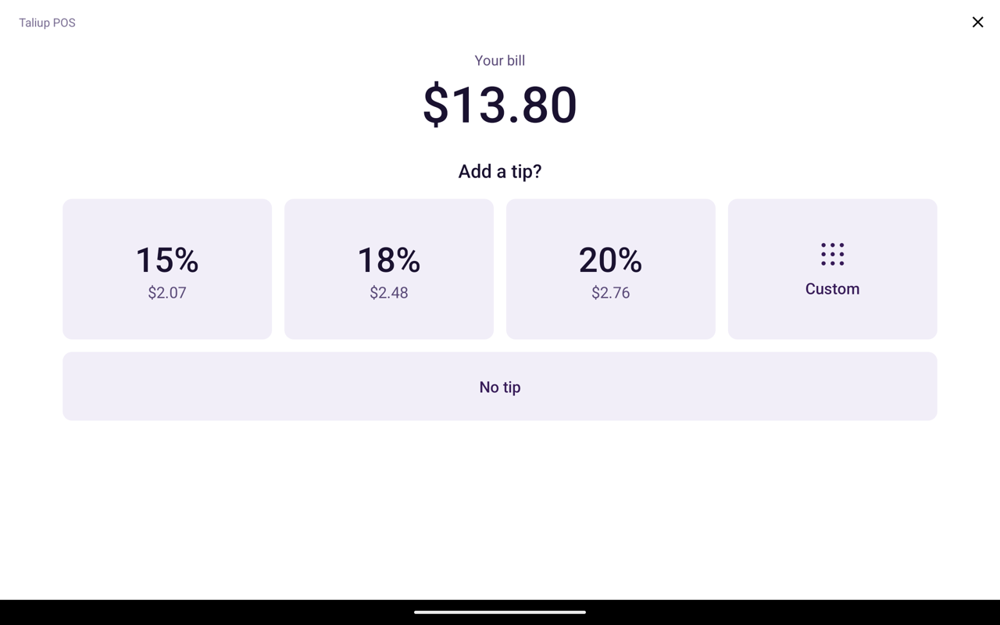
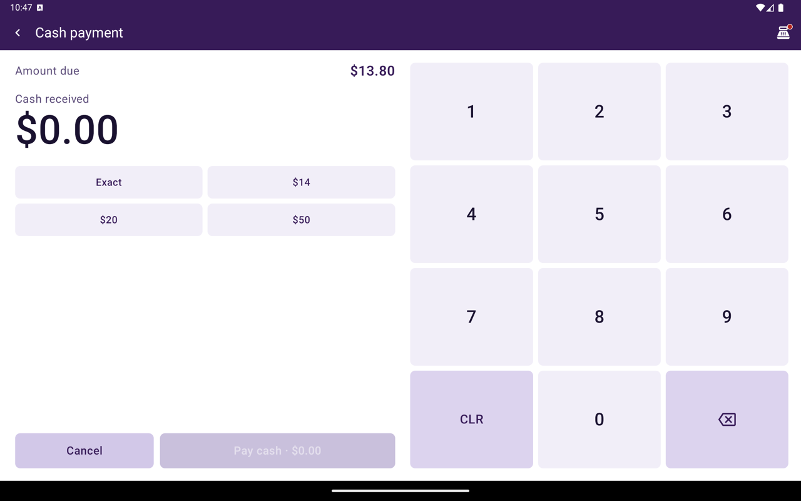

When the order is ready, charge it with the tender keys at the bottom of Register. Each key shows the amount it will charge, for example **Card: $24.15**.

<Frame caption="Payment screen with Pay Full / Split Amount and card/cash options.">
  
</Frame>

## Tender keys

The bar shows **Cash**, the card key and, when there is room, **Split**. Everything else is under **More** (**More payment types**).

| Key | When it appears |
|---|---|
| **Cash** | Your business accepts cash. The amount is rounded to the nearest 5¢, except on Poynt |
| **Card**, **Credit**, **Debit** | Your business accepts cards. See [Card keys](#card-keys) |
| **Split** | Not on WEB-SRM registers |
| **Gift card** | Gift cards are activated for this location. Not when the sale loads a gift card |
| **EBT** | Your business accepts EBT. Not when the sale loads a gift card |
| **Other** | WEB-SRM registers only |
| **L2P** (Link To Pay) | Your business uses [Link to Pay](/taliup-pos/link-to-pay). Not when paying one guest |
| **Manual entry** | Elavon card readers (Link 2500, Lane 3600): key the card number on the reader. Added in [November 2026](/changelog/2026-11) |

## Card keys

Which card keys you see depends on how your business is set up in Taliup HQ:

| Setup | Card keys |
|---|---|
| The terminal detects credit or debit automatically | One **Card** key |
| The terminal detects automatically, and a credit card surcharge is on without dual pricing | **Credit** and **Debit** |
| Any other setup | **Credit** and **Debit**, for the types your business accepts |

**Dual pricing** shows a card price that includes a non-cash adjustment. The **Credit** key always includes it. **Debit** includes it only when your business applies dual pricing to debit.

A **credit card surcharge** applies to credit only, and only when dual pricing is off. The **Credit** key shows the total with the surcharge.

## Card payment

<Steps>
  <Step title="Tap the card key">
    Tap **Card**, **Credit**, **Debit** or **Manual entry**.
  </Step>
  <Step title="The customer answers the prompts">
    Depending on your setup, in this order:
    1. Dual pricing: **How would you like to pay?** The customer taps **Pay [amount] by card**, or **Cash** to stop and pay cash instead.
    2. Tip: **Add a tip?** See [Tips](/taliup-pos/register/tips).
    3. Surcharge: **Credit Card Surcharge** with the **Total to be charged**. The customer taps **Agree & pay [amount]**, or **Pay With Debit** to avoid it. **Pay With Debit** is not offered with **Manual entry** or when the terminal detects the card type automatically.
  </Step>
  <Step title="Present the card">
    Follow the card reader: **Tap, insert or swipe card on the reader**.
  </Step>
  <Step title="Finish">
    After approval, Taliup POS records the payment and may ask how the customer wants a receipt.
  </Step>
</Steps>

The prompts appear where the tip prompt does: on a customer display, on a separate PAX payment terminal, or on the Taliup POS screen.

## Cash payment

Tap **Cash**. On Poynt, the cash payment is recorded right away. On other devices the payment screen opens:

1. In the **CASH** section, select one of the three suggested amounts and tap **Pay Cash**, or tap **Custom**.
2. With **Custom**, type the cash received or tap a suggestion such as **Exact**, then tap **Pay cash · [amount]**. The change is shown.
3. On **Confirm Cash Payment**, tap **Confirm · [amount]**.

<Frame caption="Cash tender screen showing change due.">
  
</Frame>

## Split a payment

Tap **Split** to open the payment screen on **Split Amount**. Choose **Remaining**, a number of ways such as **2 ways**, or **Custom**, then **Charge this portion** and pick the tender. After each portion, take the **Next payment** or tap **Pay later** to save the rest. **Pay Full** charges the whole remaining balance.

On a table order, open a guest's options and tap **Pay** to charge only that guest's balance.

## After payment

Depending on settings and the order:

1. **Send To Kitchen Printer** — send items to kitchen printers. It happens automatically when **Send order to external printer after payment** is on. See [Printers](/taliup-pos/settings/printers).
2. **Choose customer receipt** — **No Receipt**, **Paper** or **Email**. See [Customer receipt](/taliup-pos/register/customer-receipt).
3. On a split sale, **Choose full order customer receipt** after the last payment.
4. On some table orders, **Order Fully Paid** or **Guest Fully Paid** print prompts, unless **Skip Fully Paid Receipt Prompts** is on.

The merchant copy prints unless **Skip Merchant Receipt Copy** is on. See [General settings](/taliup-pos/settings/general).

Completed payments appear in [Transactions](/taliup-pos/transactions).

## Related

- [Tips](/taliup-pos/register/tips)
- [Open Sale Only](/taliup-pos/register/open-sale-only)
- [Gift cards](/taliup-pos/register/gift-cards) · [Loyalty](/taliup-pos/register/loyalty)
- [Void](/taliup-pos/transactions/void) · [Refund](/taliup-pos/transactions/refund)
