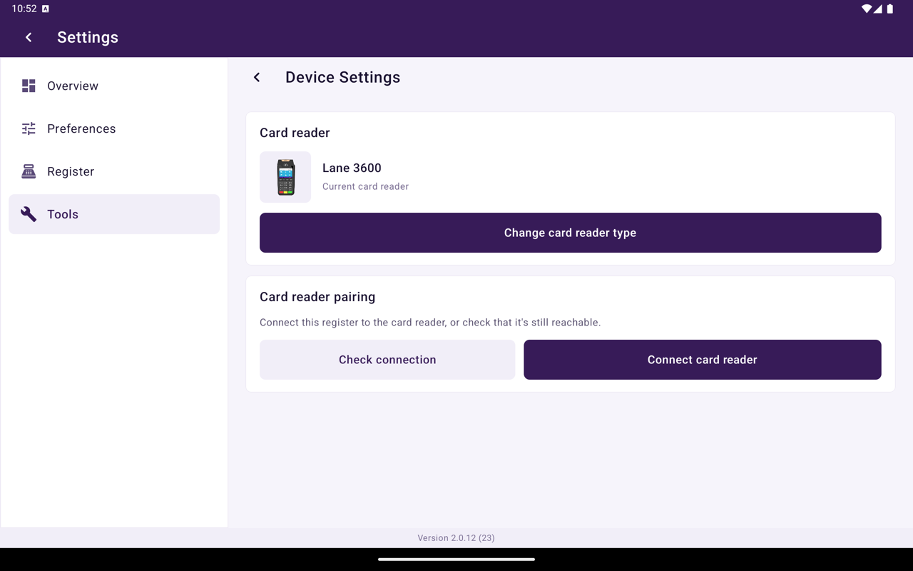

**Device Settings** sets how this terminal reaches the card reader that takes card payments. What the screen shows depends on the card reader selected for this terminal.

<Frame caption="Device Settings with card reader type and connection options.">
  
</Frame>

## How to get here

Home → **Settings** → **Tools** → **Device Settings**.

**Device Settings** is not available on Poynt terminals, where the card reader is built in.

## Card reader

The **Card reader** card shows the **Current card reader**: PAX A920Pro, Elys, Link 2500, Lane 3600, S1P2 or S1F4 PRO.

To change it:

1. Tap **Change card reader type**.
2. Select your card reader device, then tap **Next**.

<Warning>
  The card reader type decides how Taliup POS sends card payments. Choose only the reader that is installed with this terminal; a wrong choice stops card payments until you change it back.
</Warning>

## Connection type

For S1P2 and S1F4 PRO readers, **Connection type** chooses **USB** or **IP**. When you choose **IP**, enter the reader's address under **Card reader connection**.

## Card reader connection

Shown when the reader connects over IP and no Companion app is used.

1. Enter the reader's **IPv4 Address** and **Port**.
2. For Link 2500 and Lane 3600 readers, choose the **Encryption scheme**.
3. Tap **Save**.

## Card reader pairing

For Link 2500 and Lane 3600 readers, **Card reader pairing** connects this register to the reader:

- **Connect card reader** — finds the reader and connects to it.
- **Check connection** — checks that the reader is still reachable.

## Companion connection

Some setups run the cashier screen on one device and hand card payments to the **Taliup Companion** app on a separate PAX terminal — for example an Elys cashier terminal with its customer-facing terminal. On these setups, **Companion connection** replaces the card reader connection fields.

| Control | What it does |
|---|---|
| **USB preferred** | Tries the direct device-to-device links first. The TCP address is used only when they are not available, so it is optional. |
| **TCP only** | Connects over Wi-Fi or a local network only. Enter the Companion **IPv4 Address** and **Port**. |
| **Status** | **Connected**, **Connecting**, **Disconnected** or **Failed** |
| **Active transport** | The link in use right now |
| **Diagnose connection** | Tests each link and opens a **Companion Diagnostics** report with a result and a recommendation |
| **Save** | Saves the TCP address and port |

### Find the Companion IP address

1. On the customer-facing terminal, open **Taliup Companion** and wait for its idle screen.
2. Double-tap or long-press the screen. The IP address and port appear in the top-left corner for a few seconds.
3. Enter them under **Companion connection**. The default port is **12345**.

### Keep the connection reliable

- Keep both devices on the same Wi-Fi network. Avoid guest networks and separate network segments.
- Keep **Taliup Companion** open on the customer-facing terminal, and do not switch away from it during a payment.
- With **TCP only**, ask your IT provider for a fixed IP address for the customer-facing terminal. If it changes, update **IPv4 Address**.
- A device that goes to sleep can drop the connection. Wake both devices and wait for it to reconnect.

### Companion disconnected banner

When the link drops, Register and Transactions show **Companion display disconnected - please wait for reconnection or click Connection Diagnosis.** The banner clears by itself when the connection returns. Tap **Connection Diagnosis** to run the same test as **Diagnose connection**. During a card payment the banner can stay hidden; if the payment fails, check the connection afterwards.

## Troubleshooting

| Situation | What to check |
|---|---|
| **Device Settings** is missing | The terminal is a Poynt terminal; its reader needs no setup here. |
| Card payments stopped after changing the reader | Change the card reader type back to the reader installed with this terminal. |
| Diagnosis shows **No local network** | Connect this register to the same Wi-Fi or local network as the Companion terminal. |
| Diagnosis shows **Host unreachable** or **TCP port closed** | Check the IP address and port shown on the Companion idle screen, put both devices on the same network, and open Companion. |
| Diagnosis shows **Protocol failed** | Something other than Companion answered on that address. Check the IP address and port. |
| Payment fails before the card prompt | Restore the Companion connection first, then retry the sale. |

Still stuck? See [Get help](/taliup-pos/help/support).

## Related

- [Settings](/taliup-pos/settings)
- [Take payment](/taliup-pos/register/take-payment)
- [Getting started](/taliup-pos/settings/getting-started)
