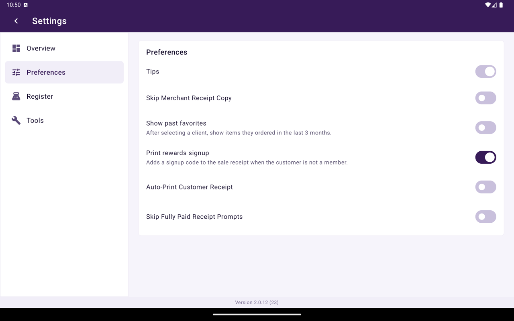
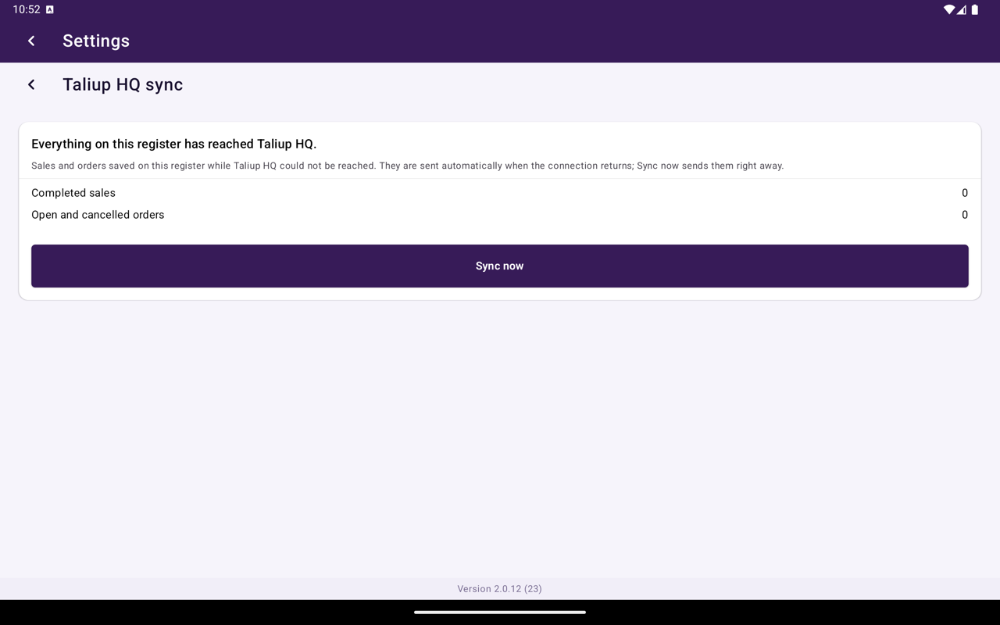

The general sections of Settings — **Preferences**, **Register** and **Tools** — control receipts, Register defaults and maintenance on this terminal. To find a section in portrait or landscape, see [Settings](/taliup-pos/settings#portrait-and-landscape).

<Frame caption="General settings with Weighable items set to Enter weight.">
  
</Frame>

Unless a row says otherwise, a setting applies to this terminal only.

## Preferences

Home → **Settings** → **Preferences**.

| Control | What it does |
|---|---|
| **Tips** | Shows whether tips are on for the business. Display only — tips are set up in Taliup HQ. See [Tips](/taliup-hq/onboarding/tips). |
| **Skip Merchant Receipt Copy** | Does not print the merchant copy. |
| **Show past favorites** | After you pick a client, shows items they ordered in the last 3 months. Attaching clients needs the **Clients** feature. See [Attach from Register](/taliup-pos/clients/attach-from-register). |
| **Print rewards signup** | Adds a loyalty signup code to the sale receipt when the customer is not a member. Shown when Loyalty is active at this location. See [Loyalty](/taliup-pos/register/loyalty). |
| **Auto-Print Customer Receipt** | Prints the customer copy after payment and skips **Choose customer receipt**. Not shown on WEB-SRM terminals. |
| **Skip Fully Paid Receipt Prompts** | Skips **Guest Fully Paid** and **Choose full order customer receipt**. Does not skip **Choose customer receipt** after each payment. Not shown on WEB-SRM terminals. |

When **Show past favorites** is on:

| When | What happens |
|---|---|
| You attach a client from Register | **Past favorites** opens so you can set quantities and add those items before continuing |
| A client is already on the order | **Client Attached** includes **Past favorites** so you can reopen that list |

After payment, staff or the customer choose **No Receipt**, **Paper** or **Email**. See [Customer receipt](/taliup-pos/register/customer-receipt).

## Register

Home → **Settings** → **Register**.

### Open sale taxes

**Open sale taxes** chooses which taxes Open Sale amounts are charged. This setting is shared by every terminal of the business. It is not shown on WEB-SRM terminals.

1. Turn on **Apply taxes on open sale**.
2. Turn on each tax to apply.

Changing the taxes requires the **Update Taxes** permission. If the business has no taxes, Taliup POS shows **This business has no taxes yet. Add one in Taliup HQ, then choose it here.** See [Open a sale](/taliup-pos/register/open-sale).

### Kitchen printing after payment

**Send order to external printer after payment** sends the kitchen ticket after payment without asking. It can be turned on only when a kitchen printer is set up in **Printer Settings**; until then it shows **Add a kitchen printer in Printer Settings to turn this on.** It cannot be turned on for an Open Sale Only business. See [Printers](/taliup-pos/settings/printers#add-a-kitchen-or-external-printer).

### Assigned Catalog

**Assigned Catalog** chooses which catalog or menu this terminal sells from. Pick it from the list. If none exist, Taliup POS shows **No catalogs available.** Tap **Retry** if loading fails.

### Default Screen After Login

**Default Screen After Login** opens **Home** or **Register** after an employee signs in. New terminals open **Home**. Not shown on an Open Sale Only business, which always opens the Open Sale screen.

### Default Register View

**Default Register View** chooses whether Register opens on **Open Sale** or on **Catalog** (**Menu** for restaurants). It is shown only when this terminal has an assigned catalog and the business has catalog selling; otherwise Register always opens on **Open Sale**. See [Open a sale](/taliup-pos/register/open-sale).

**Default Screen After Login** decides where you land after signing in; **Default Register View** decides what Register shows once it is open.

### Weighable Items

Shown when this terminal has an assigned catalog. **Weighable Items** chooses how cashiers add items sold by weight:

- **Enter Weight** (default) — tap the item, type the weight, and Register charges the catalog price per unit × weight.
- **Scale Labels** — scan the printed scale sticker. Tapping the item does not add a quantity of 1.

See [Scale barcodes](/taliup-pos/register/scale-barcodes) and, for product setup, [Scale items](/taliup-hq/features/scale-items).

## Taliup HQ sync

Home → **Settings** → **Tools** → **Taliup HQ sync**.

**Taliup HQ sync** lists sales and orders saved on this register while Taliup HQ could not be reached. They are sent automatically when the connection returns. **Sync now** sends them right away.

<Frame caption="Taliup HQ sync when nothing is waiting on this register.">
  
</Frame>

| Row | What it counts |
|---|---|
| **Completed sales** | Paid sales that have not reached Taliup HQ |
| **Open and cancelled orders** | Open or cancelled orders still waiting to upload |
| **WEB-SRM records** | Fiscal records waiting for Taliup HQ, on WEB-SRM terminals only |

When nothing is waiting, Taliup POS shows **Everything on this register has reached Taliup HQ.** Records that cannot be sent stay on the register and are retried automatically. The WEB-SRM **Pending sync** screen also links here. See [Working offline](/taliup-pos/offline).

## Clear application data

Home → **Settings** → **Tools** → **Clear Application Data**.

Clearing wipes this terminal's local app data after you confirm. The app closes, and you reopen it and sign in again. Use it only when support asks you to.

If completed transactions have not reached Taliup HQ yet, the sheet **Transactions not yet sent to Taliup HQ** lists them and offers **Go to Taliup HQ sync**. **Clear application data anyway** stays disabled until you confirm that those transactions will be deleted from this register and will not appear on Taliup HQ. Sync first unless support tells you otherwise.

## Exit Demo Mode

During a demo session, **Exit Demo Mode** appears under **Tools**. Tap it to leave demo mode.

## Related

- [Settings](/taliup-pos/settings)
- [Printers](/taliup-pos/settings/printers)
- [Device settings](/taliup-pos/settings/device)
