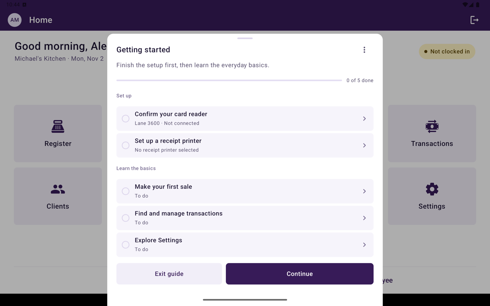
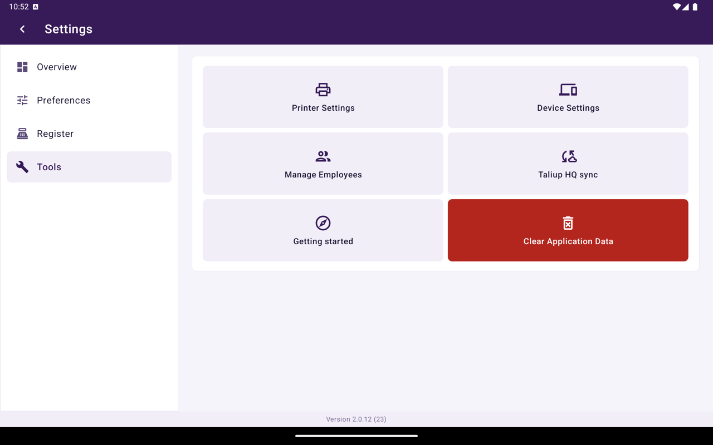

**Getting started** is a first-run guide on this terminal. It walks you through setup, then the everyday basics. After an update, Taliup POS also shows [What's new](/taliup-pos/settings#whats-new).

## How it opens

The first time you sign in after this version is installed, **Getting started** opens with **Set up this register and learn the basics in a few minutes.**

- Tap **Get started** to begin.
- Tap **Not now** to close it. Reopen it later from Settings.

Before you sign in, the login screen can show **Before you sign in**: your name and PIN are in the welcome email from Taliup, and the Device ID is in Taliup HQ → **Settings** → **Devices**.

## Checklist

<Frame caption="Getting started checklist on the terminal.">
  
</Frame>

The guide has two sections. Finish **Set up** first, then **Learn the basics**.

| Step | What you do |
|---|---|
| **Confirm your card reader** | Connect or check the reader so card payments can start |
| **Set up a receipt printer** | Choose a receipt printer if this terminal cannot print |
| **WEB-SRM setup** | Shown only when this business uses WEB-SRM. Finish the device certificate and employee registration from Home |
| **Make your first sale** | Add a small amount or items, then take payment. This is a real sale |
| **Find and manage transactions** | Open **Transactions** to search, void, refund, or run End of Day |
| **Explore Settings** | See where preferences, register options, and tools live |

Each step points at the control it describes and offers **Learn more**. You can **Skip** a step or tap **Later**.

<Note>
  **Make your first sale** records a real payment. Use a small amount. In demo mode the guide only explains checkout.
</Note>

## During a sale

If you leave the guide to take a sale, it collapses to a **Getting started** progress pill. After the sale, tap the pill to continue.

## Reopen the guide

Home → **Settings** → **Tools** → **Getting started**.

<Frame caption="Tools in Settings, including Getting started and Taliup HQ sync.">
  
</Frame>

You can reopen it after you finish or skip it. The completed screen says **You're all set**.

## Related

- [First login](/taliup-pos/first-login)
- [Settings](/taliup-pos/settings)
- [Device](/taliup-pos/settings/device)
- [Printers](/taliup-pos/settings/printers)
