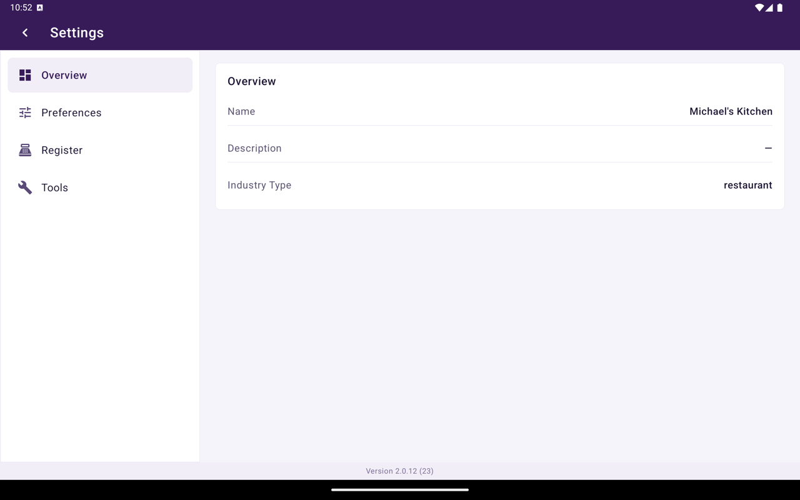
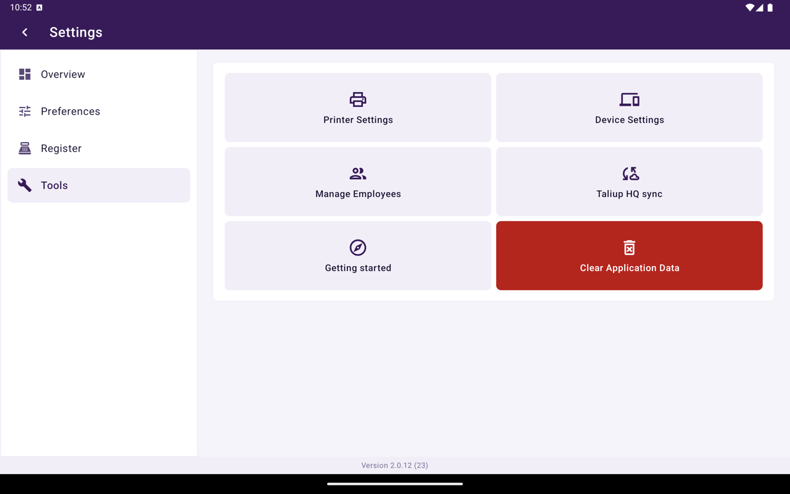

**Settings** controls how this terminal behaves: receipt preferences, Register defaults, printers, the card reader, and maintenance tools. Most settings stay on this terminal only.

<Frame caption="Settings on Taliup POS.">
  
</Frame>

## Open Settings

- From Home: tap **Settings**.
- On an Open Sale Only business: tap **Options** → **Open Settings**.

The rest of the path is the same in both cases. These docs write a setting's location as Home → **Settings** → section → control, for example Home → **Settings** → **Tools** → **Printer Settings**.

## Sections

| Section | What is in it |
|---|---|
| **Overview** | Business **Name**, **Description** and **Industry Type** (read only) |
| **Preferences** | **Tips** indicator and receipt options — see [General settings](/taliup-pos/settings/general#preferences) |
| **Register** | Open sale taxes, kitchen printing after payment, **Assigned Catalog**, default screens and **Weighable Items** — see [General settings](/taliup-pos/settings/general#register) |
| **Tools** | **Printer Settings**, **Device Settings**, **Manage Employees**, **Taliup HQ sync**, **Getting started** and **Clear Application Data** |
| **WEB-SRM** | Only on terminals that record sales with Revenu Québec — see [WEB-SRM settings](/taliup-pos/web-srm/settings) |

### Portrait and landscape

- **Portrait** (handheld terminals): the sections are stacked on one scrolling page — **Overview**, **Preferences**, the Register settings, then the Tools tiles at the bottom. On WEB-SRM terminals, **General** and **WEB-SRM** tabs appear at the top; **General** is selected and holds the stacked sections.
- **Landscape** (tablets and counter terminals): pick **Overview**, **Preferences**, **Register**, **Tools** or **WEB-SRM** in the navigation on the left. Only that section is shown.

## Tools

<Frame caption="Settings → Tools.">
  
</Frame>

| Tile | Opens |
|---|---|
| **Printer Settings** | [Printers](/taliup-pos/settings/printers) |
| **Device Settings** | [Device settings](/taliup-pos/settings/device) — card reader connection. Not shown on Poynt terminals. |
| **Manage Employees** | [Employees](/taliup-pos/settings/employees) |
| **Taliup HQ sync** | [Taliup HQ sync](/taliup-pos/settings/general#taliup-hq-sync) — sales waiting to reach Taliup HQ |
| **Getting started** | [Getting started](/taliup-pos/settings/getting-started) — the first-run guide |
| **Clear Application Data** | [Clear application data](/taliup-pos/settings/general#clear-application-data) |

During a demo session, **Exit Demo Mode** appears below the tiles.

## In this section

| Page | What it covers |
|---|---|
| [General settings](/taliup-pos/settings/general) | Preferences, Register settings, Taliup HQ sync, Clear Application Data |
| [Getting started](/taliup-pos/settings/getting-started) | First-run setup and everyday basics |
| [Printers](/taliup-pos/settings/printers) | Bluetooth printers, receipt printer, kitchen and other external printers |
| [Device settings](/taliup-pos/settings/device) | Card reader type, connection and Companion connection |
| [Employees](/taliup-pos/settings/employees) | Employees on this business |

## App version and What's new

The bottom of Settings shows the installed version, for example **Version 2.0.13 (31)**. Support may ask for it, and the [changelog](/changelog) lists versions by channel.

After an app update, Taliup POS shows what changed. To read it again, tap the version at the bottom of Settings. On an Open Sale Only business, the version is shown but does not open What's new.
