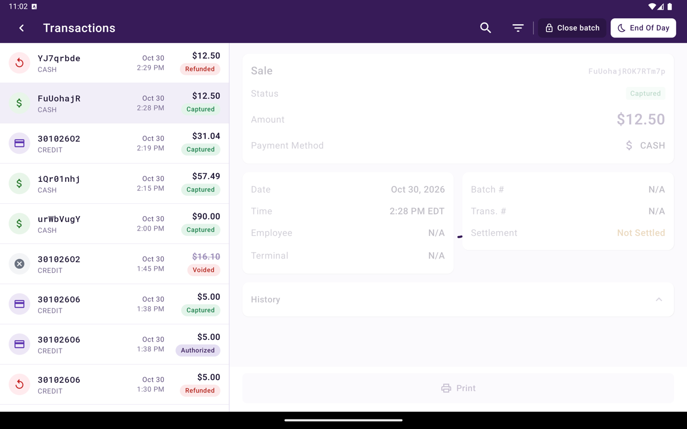

Tap a payment in [Transactions](/taliup-pos/transactions) to open **Transaction Details**. In landscape the details appear beside the list.

## Before you start

To open **Transactions**, you need the **Manage Transactions** permission and a connection to Taliup HQ.

<Frame caption="Transaction Details with status, amount, and action buttons.">
  
</Frame>

## What you see

| Field | Description |
|---|---|
| Type and reference | The transaction type with its payment reference |
| **Status** | Current status, colour-coded |
| **Amount** | The amount. Cash payments also show **Tendered** and **Change** |
| **Payment Method** | Cash or Other, or the card type, cardholder and last four digits. Gift cards show **GIFT CARD** |
| **Date** / **Time** | When it was taken |
| **Employee** | Who took it |
| **Terminal** | Terminal model and serial number, when known |
| **Batch #** / **Trans. #** | Processor references, when available |
| **Settlement** | **Settled** or **Not Settled** |
| **Auth code** / **Order** | In landscape, when available |
| **History** | Tap to expand the status and amount changes |

## Actions

The buttons at the bottom appear only when the payment allows them.

| Button | What it does | When it appears |
|---|---|---|
| **Print** | Prints the **Merchant copy** or **Customer copy**. Payouts show **Print Receipt** | Always |
| **Adjust Tip** | Changes the tip. See [Tips](/taliup-pos/register/tips#adjust-a-tip) | Card payments (not EBT) that are not settled, with the **Tip Adjust** feature, on PAX, Castles or Poynt terminals |
| **Void** | Reverses the payment before settlement. See [Void](/taliup-pos/transactions/void) | Captured payments that are not settled. Needs **Manage Transactions** |
| **Refund** / **Return** | Refunds all or part of the payment. **Return** is the label for Cash and Other. See [Refund](/taliup-pos/transactions/refund) | Settled payments with an amount left to refund. Needs **Manage Transactions** |
| **Post Auth** | Captures a pre-authorization. See [Pre-authorizations](/taliup-pos/register/pre-auth) | Authorizations that are not settled. Needs **Post-Authorization** |
| **Void Auth** | Releases a pre-authorization | Authorizations that are not settled, except on Elavon card readers. Needs **Manage Transactions** |
| **Delete Auth** | Removes a pre-authorization | Elavon card readers (Link 2500, Lane 3600) |

**Void**, **Post Auth**, **Void Auth** and **Delete Auth** ask you to confirm first, for example **Void this transaction?**. Voids and released authorizations cannot be undone.

## Things to know

- **Card actions stay on the terminal that took the payment.** Voids, refunds, tip adjustments and authorization captures run in that terminal's payment app. On another device, Taliup POS shows which terminal processed the payment.
- **Poynt** reads the live status from the Poynt terminal. If it cannot, the details show **Live Poynt status unavailable.** and no card actions.
- If the payment cannot be loaded, you see **Transaction unavailable**. Go back and try again.

To reprint or email a receipt, see [Reprint](/taliup-pos/transactions/reprint) and [Customer receipt](/taliup-pos/register/customer-receipt).

## Related

- [Search and filters](/taliup-pos/transactions/search-and-filters)
- [Close a batch](/taliup-pos/transactions/close-batch)
