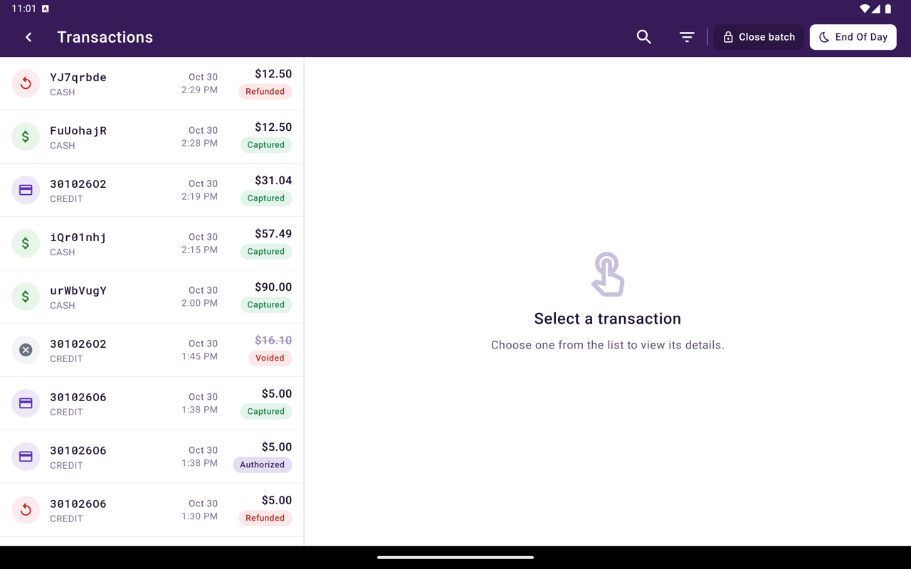

**Transactions** lists payments, refunds and payouts. From here you open a payment to void, refund or reprint it, close the batch, or run End of Day.

## Before you start

- Opening **Transactions** needs the **Manage Transactions** permission. Without it, Taliup POS shows a permission message instead. Ask a manager to change your role in Taliup HQ.
- The list shows the transactions taken on this terminal. With the **View All Terminal Transactions** permission, it shows every terminal of your business.
- The list comes from Taliup HQ, so it needs a connection.

## Open Transactions

- From Home, tap **Transactions**.
- On the [Open Sale Only](/taliup-pos/register/open-sale-only) screen, tap **Options** → **View Transactions**.

<Frame caption="Transactions list with ID, Date/Time, and Total columns.">
  
</Frame>

## What the list shows

Each row shows:

- A short payment reference. On WEB-SRM registers it is the transaction number printed on the receipt.
- The tender, such as the card type and last four digits, **CASH** or **GIFT CARD ····1234**.
- The date and time, and the amount. A voided payment's amount is struck through.
- An icon for the payment method, coloured by status (for example captured, authorized, voided or refunded).

In landscape, the list and the selected payment's details appear side by side. Choose a payment to see its details. In portrait, tapping a payment opens [Transaction details](/taliup-pos/transactions/details).

## Search and filter

- Tap the search icon and type a reference, card or amount.
- Tap the filter icon to open **Filter Transactions** (date range, **Status**, **Transaction Type**, **Payment Method**, **Settlement Status**). See [Search and filters](/taliup-pos/transactions/search-and-filters).

## Actions on this screen

| Action | Where | Guide |
|---|---|---|
| **Close batch** | Bottom of the list in portrait, app bar in landscape | [Close a batch](/taliup-pos/transactions/close-batch) |
| **End Of Day** | Next to **Close batch** | [End of Day](/taliup-pos/transactions/end-of-day) |

## Common follow-ups

<CardGroup cols={2}>
  <Card title="Void" href="/taliup-pos/transactions/void">
    Cancel an unsettled captured payment.
  </Card>
  <Card title="Refund (Return)" href="/taliup-pos/transactions/refund">
    Full or partial refund of a settled payment.
  </Card>
  <Card title="Reprint" href="/taliup-pos/transactions/reprint">
    Print the merchant or customer copy again.
  </Card>
  <Card title="Details" href="/taliup-pos/transactions/details">
    Status, history, terminal and the actions available.
  </Card>
  <Card title="Close a batch" href="/taliup-pos/transactions/close-batch">
    Settle the open card batch.
  </Card>
  <Card title="End of Day" href="/taliup-pos/transactions/end-of-day">
    Preview, generate and print a daily report for one or more devices.
  </Card>
</CardGroup>
