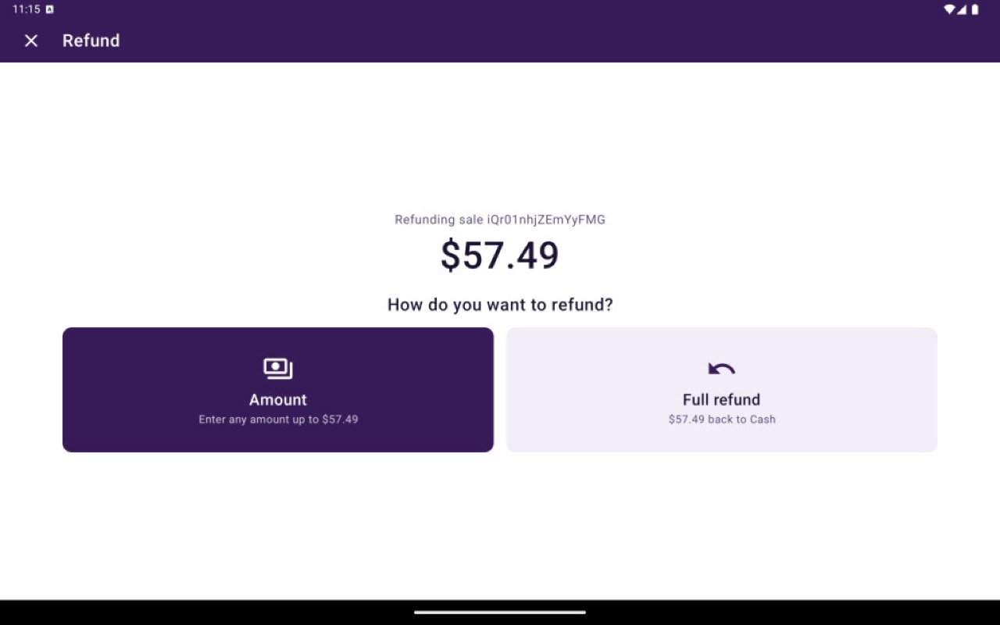
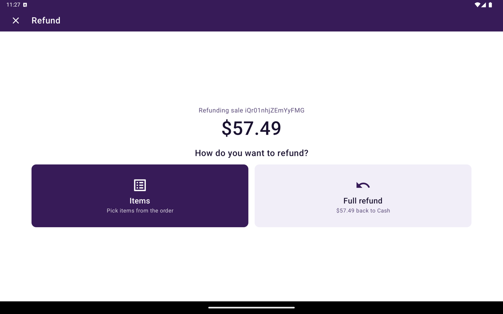
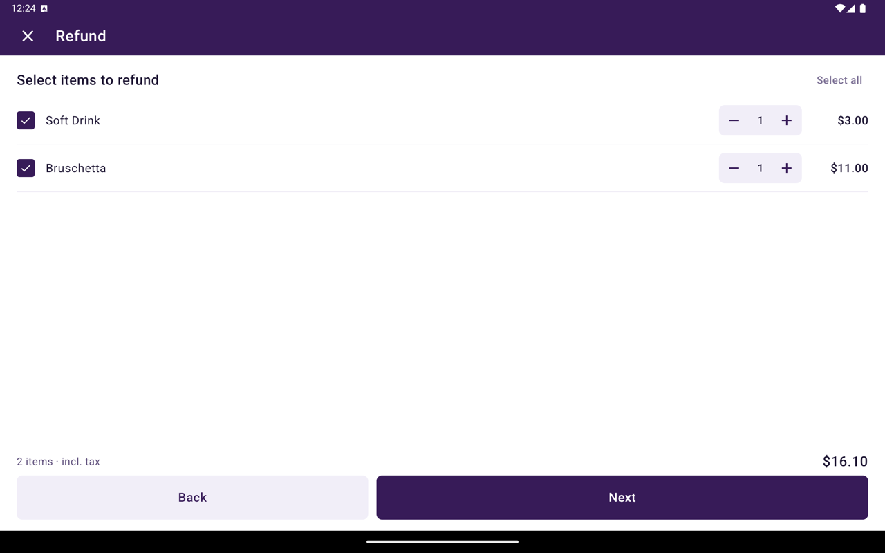

In Transaction Details, refunds start with **Return**. You can refund the full amount, a custom amount, or selected items — depending on the original sale.

<Frame caption="Refund. Amount lets you enter any amount up to the remaining total. Full refund sends the whole amount back to the original tender.">
  
</Frame>

## Before you start

- You need permission to manage transactions.
- **Return** appears when the payment is eligible (for example settled/captured with a remaining refundable amount, or already partially refunded).
- Partial options are hidden for table orders — use **Full refund** in that case.
- On a [WEB-SRM](/taliup-pos/web-srm) device, **Amount** is replaced by **Items** so the fiscal credit note can list the returned lines.
- If **Return** is missing, the payment may already be fully refunded/voided, or your role cannot manage transactions.

## Start a return

<Steps>
  <Step title="Open the payment">
    Go to Home → **Transactions** and open the sale.
  </Step>
  <Step title="Tap Return">
    Tap **Return**.
  </Step>
  <Step title="Choose how to refund">
    On **How do you want to refund?**, choose one of the paths below.
  </Step>
</Steps>

## Full refund

1. Tap **Full refund**. The tile shows the remaining amount and the original tender (for example **$57.49 back to Cash**).
2. On **Confirm refund**, enter the **Name on receipt** when asked.
3. Tap **Refund** and complete any terminal prompts.
4. Taliup POS processes the return and typically reprints a merchant copy before returning to the list.

## Partial refund (amount)

Shown when the sale is not on WEB-SRM.

<Steps>
  <Step title="Choose Amount">
    Tap **Amount**. The tile shows **Enter any amount up to** the remaining refundable total.
  </Step>
  <Step title="Enter the amount">
    Enter an amount greater than zero and not more than the remaining total. Tap **Next**.
  </Step>
  <Step title="Confirm">
    Enter the **Name on receipt** when asked, then tap **Refund**.
  </Step>
</Steps>

## Partial refund (items)

Shown on WEB-SRM when the linked order has line items (and is not a table order).

<Frame caption="Refund on WEB-SRM. Items replaces Amount so you can pick lines from the order.">
  
</Frame>

<Steps>
  <Step title="Choose Items">
    Tap **Items**.
  </Step>
  <Step title="Select items">
    On **Select items to refund**, tap **Select all** or choose individual lines, then tap **Next**.

    <Frame caption="Select items to refund. Select all or pick lines, then Next.">
      
    </Frame>
  </Step>
  <Step title="Confirm">
    WEB-SRM requires a **Name on receipt** for the fiscal credit note. Enter it, then tap **Refund**.
  </Step>
</Steps>

## Gift card and loyalty refunds

- A refund on a sale paid by gift card goes back onto the same gift card. See [Gift cards](/taliup-pos/register/gift-cards).
- A full refund reverses the loyalty points earned on the sale. See [Loyalty](/taliup-pos/register/loyalty).

## Troubleshooting

| Situation | What to check |
|---|---|
| Only **Full refund** is available | Table orders do not offer **Amount** or **Items** |
| **Next** disabled on amount entry | Amount must be &gt; 0 and ≤ remaining refundable amount |
| No **Return** button | Not eligible, already fully returned, or missing manage-transactions permission |
| Permission message | Ask a manager or update the role in Taliup HQ |

## Related

- [Void](/taliup-pos/transactions/void) — for unsettled cancellations
- [Transaction details](/taliup-pos/transactions/details)
- [Reprint](/taliup-pos/transactions/reprint)
