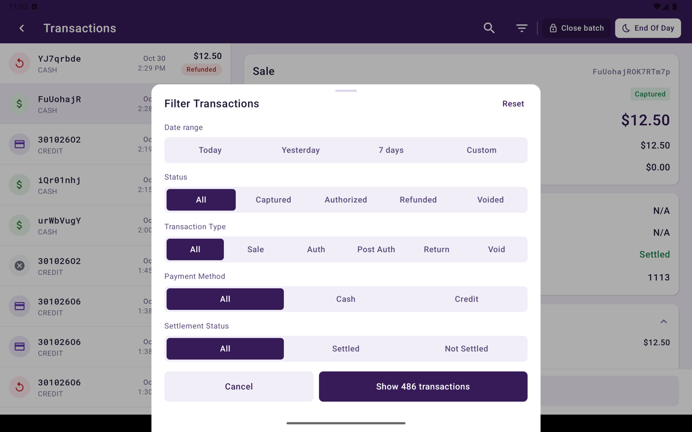

Use search and filters on the Transactions list to narrow results before opening a payment.

<Frame caption="Filter Transactions screen with status and type chips.">
  
</Frame>

## Before you start

Your role needs the **Manage Transactions** permission to open **Transactions**. The list shows the payments taken on this device unless your role also has **View All Terminal Transactions**, which shows every device's payments.

## Search

<Steps>
  <Step title="Open search">
    On **Transactions**, tap the search icon in the app bar.
  </Step>
  <Step title="Type to filter">
    Enter text to filter the list. Search also matches a [receipt token](/taliup-pos/register/receipt-barcode), including payments that have no order. Clear the field with the clear control when finished.
  </Step>
  <Step title="Dismiss">
    Tap outside the search overlay to close it.
  </Step>
</Steps>

## Filter Transactions

Tap the filter icon to open **Filter Transactions**.

| Section | Options |
|---|---|
| **Date Range** | **Select date range** (shown as `yyyy/MM/dd - yyyy/MM/dd` after you pick dates) |
| **Transaction Status** | **All**, **Captured**, **Refunded**, **Authorized**, **Voided** |
| **Transaction Type** | **All**, **Sale**, **Void**, **Auth**, **Post Auth**, **Return** |
| **Payment Method** | **All**, **Cash**, **Credit** |
| **Settlement Status** | **All**, **Settled**, **Not Settled** |

Use **Reset Filters** to clear selections. Navigate back to apply the current filters and return to the list.

## Related

- [Transaction details](/taliup-pos/transactions/details)
- [Receipt barcode](/taliup-pos/register/receipt-barcode)
