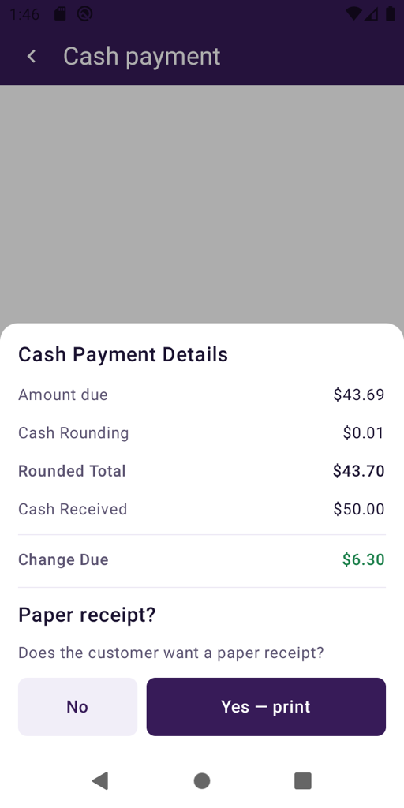
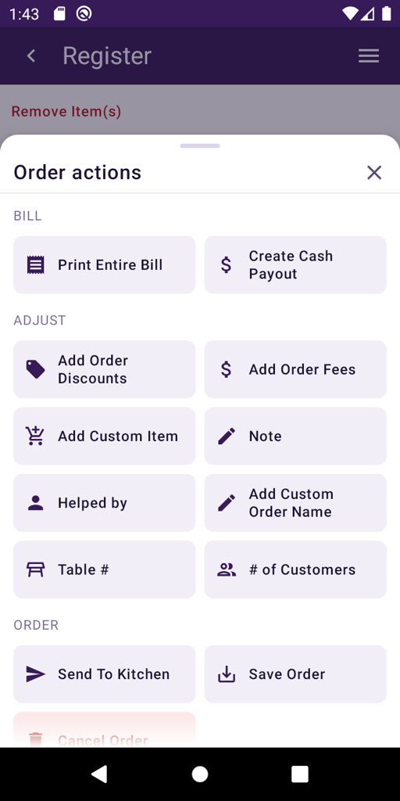
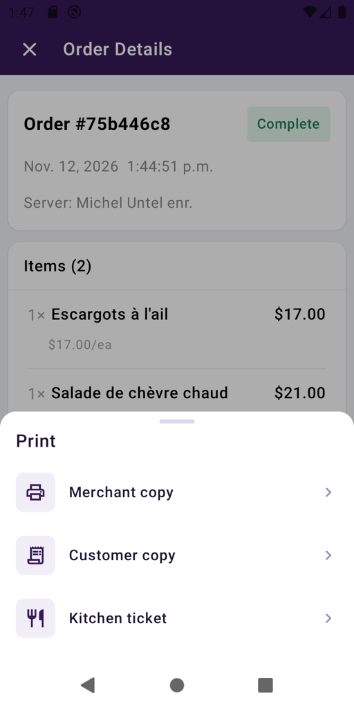
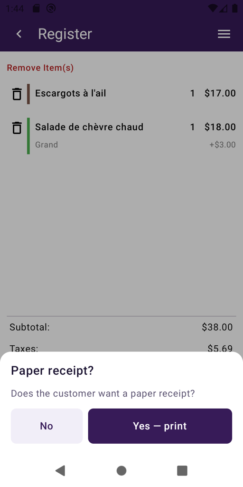
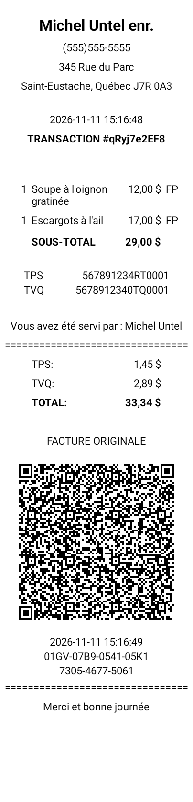

On a device enrolled with WEB-SRM, every bill and receipt is sent to Revenu Québec before it prints. The printed document carries the transaction number and QR code Revenu Québec assigned.

Fiscal documents always print in French, whatever language the device uses.

## Ask for a paper receipt

After a payment, Taliup POS asks **Paper receipt?** — **Does the customer want a paper receipt?**

- **Yes — print** prints the receipt.
- **No** records the receipt with Revenu Québec without printing it.

The same prompt appears when you save an order. It replaces the usual **No Receipt** / **Paper** / **Email** choice. See [Customer receipt](/taliup-pos/register/customer-receipt).

<Frame caption="Paper receipt prompt after a cash payment.">
  
</Frame>

## Bills and closing receipts

A bill is the temporary invoice you hand the customer before payment. A closing receipt prints when the order is paid.

| Document | How to produce it |
|---|---|
| Bill | In the **Register**, add items, open ☰ → **Print Entire Bill**. The order stays open. |
| Closing receipt after a bill | **Orders** → the order → **Open order**, then take payment. The receipt refers to the bill. |
| Closing receipt without a bill | In the **Register**, add items and take payment. |

To add items after printing a bill, reopen the order from **Orders** with **Open order**, add the items, and print the bill again.

<Frame caption="Order actions in the Register. Print Entire Bill is under Bill.">
  
</Frame>

## Customer and merchant copies

Reprint a bill or receipt from **Orders** → the order → **Print**.

| Choice | Prints | Mention |
|---|---|---|
| **Customer copy** | A reproduction for the customer | **REPRODUCTION** |
| **Merchant copy** | A duplicate for your records | **\*\*\* COPIE DU COMMERÇANT \*\*\*** / **NE PAS REMETTRE AU CLIENT** |

A copy is identical to the original: same transaction number, date, and amounts. Revenu Québec is told a copy was made.

<Frame caption="Print menu in Order Details.">
  
</Frame>

## Save an order without printing

**Save Order** keeps the order open and sends it to Revenu Québec as a bill. Use it while the customer is still ordering.

<Steps>
  <Step title="Save the order">
    In the **Register**, open ☰ → **Save Order**.
  </Step>
  <Step title="Choose paper or not">
    At **Paper receipt?**, tap **No** to save without printing, or **Yes — print** to print the bill.
  </Step>
</Steps>

To add to a saved order, open **Orders** → the order → **Open order**, add the items, and save again. Each save refers to the previous one.

<Frame caption="Save Order asks whether the customer wants paper.">
  
</Frame>

## Table number and number of customers

On a counter order, record the table and party size from **Order actions**:

- ☰ → **Table #**: up to 5 characters, then **Save**.
- ☰ → **# of Customers**: 1 to 999, then **Save**.

The bill and receipt print **TABLE #** with the number. With [Table Management](/taliup-pos/tables) on, take table orders from **Tables**: they carry their own table and party size.

## Tips

Customers add a tip on the payment screen during a card payment. Turn tips on in **Settings** → **General** → **Preferences** → **Tips**. The receipt prints the tip as **POURBOIRE**, separate from the total.

## Cash rounding

Cash payments are rounded to the nearest 5 cents. Card payments are not.

The cash payment summary shows **Cash Rounding** and **Rounded Total**. The receipt prints the rounding as **Ajustement** and the rounded total as **MONTANT DÛ**.

## Printed mentions

| Mention | Document |
|---|---|
| **FACTURE ORIGINALE** | Bill |
| **PAIEMENT REÇU** | Paid closing receipt |
| **REPRODUCTION** | Customer copy |
| **\*\*\* COPIE DU COMMERÇANT \*\*\*** / **NE PAS REMETTRE AU CLIENT** | Merchant copy |
| **NOTE DE CRÉDIT** | Refund. See [Cancel, correct, and refund](/taliup-pos/web-srm/cancel-and-correct#refunds-and-credit-notes). |
| **Facture corrigée** | Receipt that replaces a corrected one |
| **AUCUN PAIEMENT** · **FACTURE ANNULÉE** | Cancelled bill |
| **PROBLÈME DE COMMUNICATION** | Produced offline, waiting to be sent. See [Work offline](/taliup-pos/web-srm/offline). |
| **ARGENT COMPTANT**, **CARTE DE CRÉDIT**, **AUTRE MODE DE PAIEMENT** | Payment method |
| **Ajustement**, **MONTANT DÛ**, **POURBOIRE** | Cash rounding, amount due, tip |

Item options print on their own line under the item, with their price when they cost extra. An item priced $0.00 prints without an amount. Under the QR code: the date and time the document was sent, the Revenu Québec transaction number, and the device identifier.

<Frame caption="A bill (FACTURE ORIGINALE) and a paid closing receipt (PAIEMENT REÇU).">
  
</Frame>

## Troubleshooting

| Problem | What to try |
|---|---|
| **Revenu Québec rejected the fiscal transaction.** | Nothing was recorded. Tap **OK**, fix what Revenu Québec's message names, and try again. |
| **The fiscal document was created, but it could not be printed.** | The document reached Revenu Québec; only printing failed. Fix the printer, then print a **Customer copy** from **Orders**. |
| **The fiscal document was created, but the printer is out of paper.** | Load paper, then print a **Customer copy** from **Orders**. |
