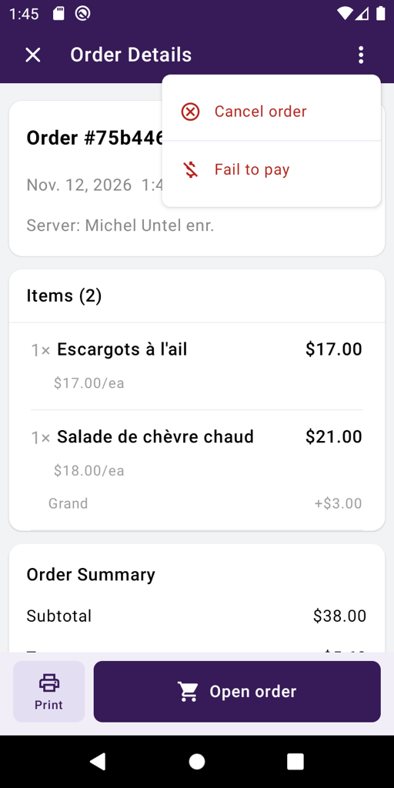
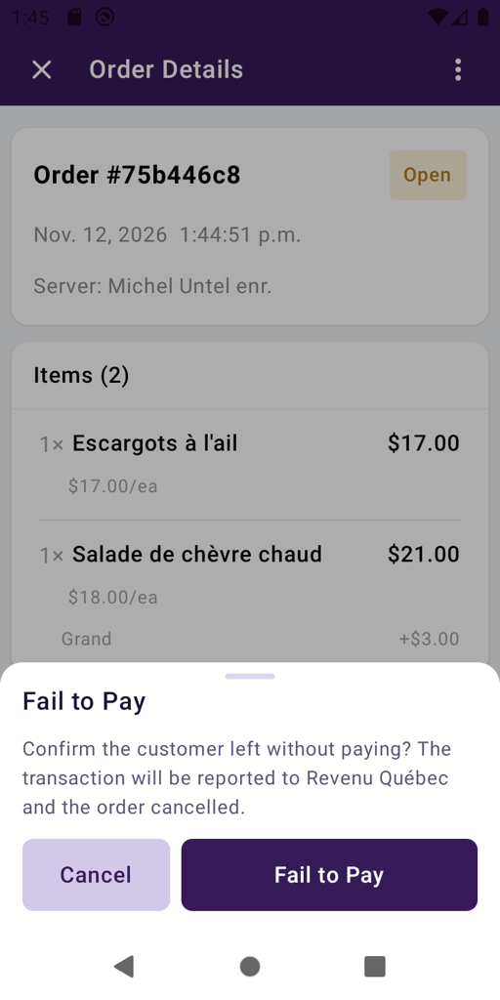
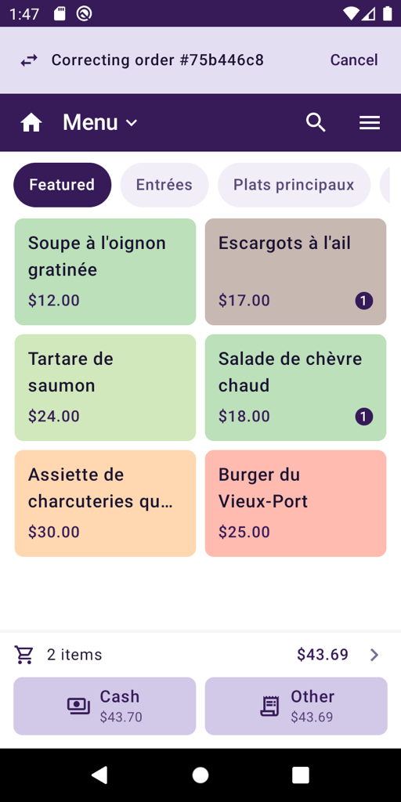
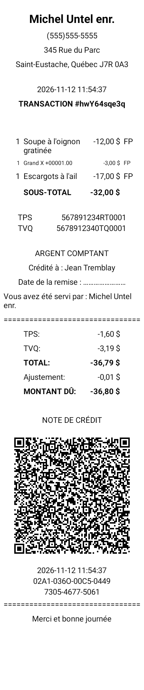

On a WEB-SRM device, every cancellation, correction, and refund is recorded with Revenu Québec. How you do it depends on whether a bill was printed or the order was paid.

## Before you start

[Enrol this device with WEB-SRM](/taliup-pos/web-srm) and sign in as an employee registered with Revenu Québec before billing.

| Situation | Use |
|---|---|
| Order being entered, no bill printed | [Cancel before the bill](#cancel-before-the-bill) |
| Bill printed, not paid, order no longer wanted | [Cancel after the bill](#cancel-after-the-bill) |
| Bill printed, customer left without paying | [Customer left without paying](#customer-left-without-paying) |
| Paid in cash or **Other**, wrong payment method or items | [Correct a paid order](#correct-a-paid-order) |
| Paid, customer returns items or gets money back | [Refunds and credit notes](#refunds-and-credit-notes) |

## Cancel before the bill

<Steps>
  <Step title="Cancel from the Register">
    In the **Register**, open ☰ → **Cancel Order**.
  </Step>
  <Step title="Confirm">
    Nothing prints. Revenu Québec is told the order was abandoned.
  </Step>
</Steps>

## Cancel after the bill

<Steps>
  <Step title="Open the order">
    Leave the **Register** with the Home button, open **Orders**, and tap the order.
  </Step>
  <Step title="Cancel from Order Details">
    In **Order Details**, open the ⋮ menu → **Cancel order**, then tap **Cancel Order** to confirm.
  </Step>
</Steps>

The terminal prints a closing receipt with the items, a "Cancellation" line, and no payment. It carries **AUCUN PAIEMENT** and **FACTURE ANNULÉE**.

<Warning>
  Once a bill has printed, always cancel from **Order Details**. **Cancel Order** in the Register treats the order as abandoned during entry and does not print the cancelled-bill receipt.
</Warning>

<Frame caption="The ⋮ menu on an open order in Order Details.">
  
</Frame>

## Customer left without paying

Record it when a customer leaves after receiving the bill.

<Steps>
  <Step title="Open the order">
    Leave the **Register** with the Home button, open **Orders**, and tap the order.
  </Step>
  <Step title="Record the failed payment">
    Open the ⋮ menu → **Fail to pay**, then tap **Fail to Pay** to confirm.
  </Step>
</Steps>

Nothing prints. Revenu Québec receives a closing receipt with the bill's amounts, marked unpaid, and the order is cancelled.

<Frame caption="Fail to Pay confirmation.">
  
</Frame>

## Correct a paid order

A correction replaces a closing receipt paid in cash or with **Other** — for example when the wrong payment method was recorded.

<Steps>
  <Step title="Start the correction">
    Open **Orders**, tap the order, then tap **Correct Order** and confirm.
  </Step>
  <Step title="Change the order">
    The **Register** opens with the order and the banner **Correcting order #…**. Change the items if needed.
  </Step>
  <Step title="Pay again">
    Pay with **Cash** or **Other**, the only methods offered during a correction.
  </Step>
</Steps>

When you pay, the terminal sends Revenu Québec a reversal of the original receipt, which does not print, then the corrected receipt, which prints with **Facture corrigée**.

Until you pay, tap **Cancel** in the banner to drop the correction. The original receipt stands.

<Frame caption="The Register during a correction. Only Cash and Other are offered.">
  
</Frame>

## Refunds and credit notes

A refund produces a credit note: a receipt with negative amounts that refers to the sale. Start it from **Transactions** → the sale → **Refund** (card) or **Return** (cash or Other). See [Refund](/taliup-pos/transactions/refund) for the full steps.

On a WEB-SRM device:

- Choose **Items** to refund some lines, or **Full refund** for the whole sale. **Amount** is not offered.
- **Name on receipt** is required. Enter the customer's name before you tap **Refund**.

| Refund | Amounts on the credit note |
|---|---|
| Items | Only the refunded items, as negative amounts. Cash rounding from the original sale is not carried over. |
| Full refund | The exact reverse of the sale, cash rounding included. |

The credit note prints **NOTE DE CRÉDIT**, a "Crédité à" line with the customer's name, and a "Date de la remise" line to fill in by hand. It is dated when the terminal produces it.

<Frame caption="A full-refund credit note.">
  
</Frame>

## Troubleshooting

| Problem | What to try |
|---|---|
| A cancelled bill printed no **FACTURE ANNULÉE** receipt | It was cancelled from the Register. Cancel billed orders from **Order Details** → ⋮ → **Cancel order**. |
| **Correct Order** offers only **Cash** and **Other** | Expected. A correction can be paid only with those methods. |
| **Refund** stays disabled | Enter **Name on receipt**. Revenu Québec requires it on a credit note. |
