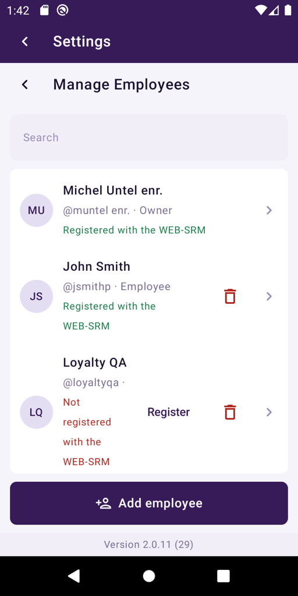
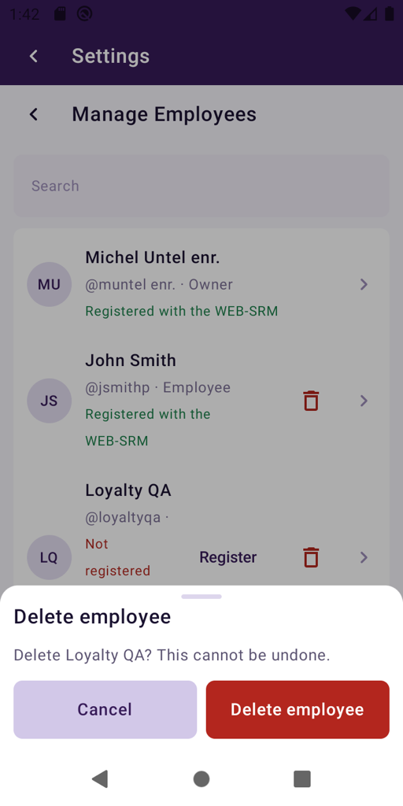

Every employee who bills on a WEB-SRM device must be registered with Revenu Québec. Taliup POS registers an employee on its own the first time they sign in on an enrolled device. The owner can also register or remove employees from **Manage Employees**.

Registration sends the employee's first and last name, with the business's GST and QST numbers.

## Open Manage Employees

Go to **Settings** → **General** → **Manage Employees**. Only the owner can open this screen.

Each employee shows **Registered with the WEB-SRM** or **Not registered with the WEB-SRM**.

<Frame caption="Manage Employees. Loyalty QA is not registered and shows a Register button.">
  
</Frame>

## Register an employee

On the employee's row, tap **Register**. The status changes to **Registered with the WEB-SRM** once Revenu Québec accepts.

## Add an employee

<Steps>
  <Step title="Open the form">
    Tap **Add employee**.
  </Step>
  <Step title="Fill it in">
    Enter the **First Name**, **Last Name**, a **Username**, and a **Passcode (6 digits)** with its confirmation. **Email (optional)** can stay empty.
  </Step>
  <Step title="Save">
    Tap **Add employee**. The registration is sent to Revenu Québec when you save.
  </Step>
</Steps>

<Note>
  A username stays reserved after its employee is deleted. Give a new employee a username that has never been used.
</Note>

## Remove an employee

On the employee's row, tap the trash icon, then **Delete employee**. Revenu Québec is told the employee no longer bills. This cannot be undone.

<Frame caption="Delete employee confirmation.">
  
</Frame>

## Troubleshooting

| Problem | What to try |
|---|---|
| **Only an owner can manage employees.** | Sign in with the owner's account. |
| An employee stays **Not registered with the WEB-SRM** | Confirm the device is online and enrolled, then tap **Register** again. |
| A new employee can't sign in to bill | Their registration did not complete. Tap **Try again** on the sheet, or register them from **Manage Employees**. |
