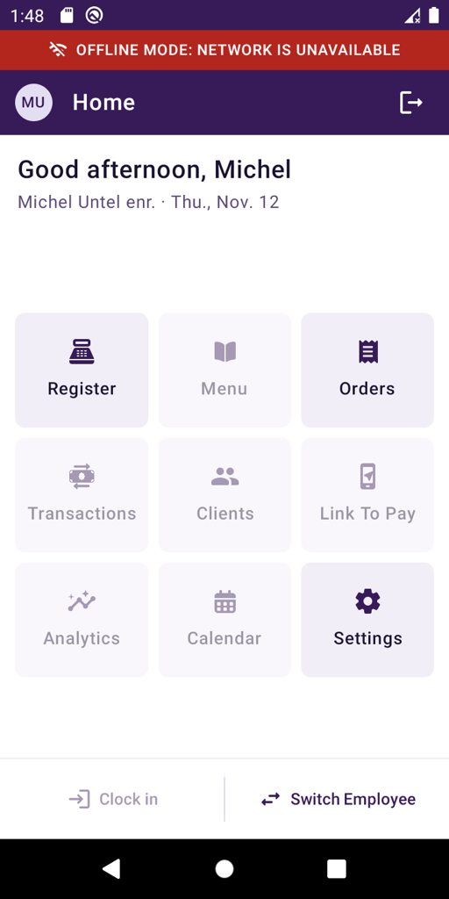
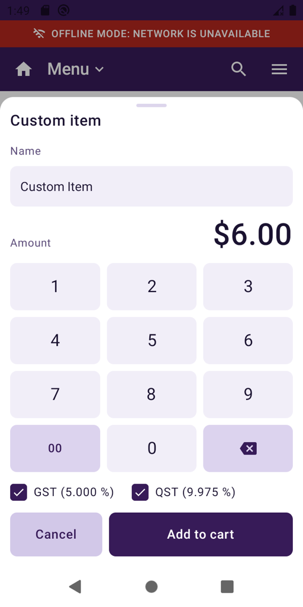
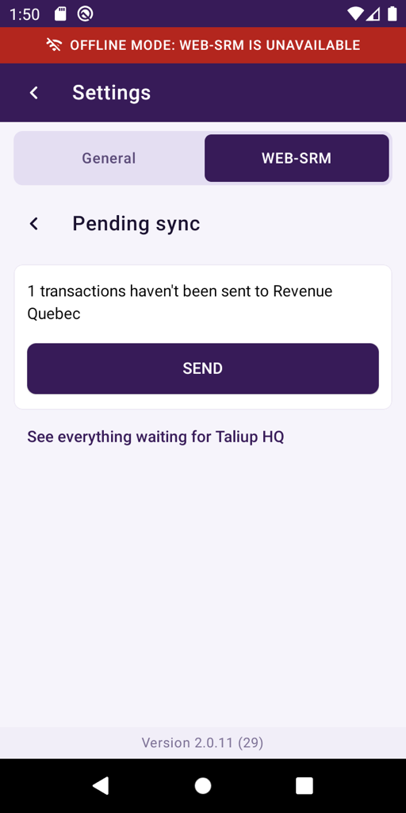

Without a network connection, Taliup POS keeps billing. Each document is signed, printed with **PROBLÈME DE COMMUNICATION**, and held in a batch for Revenu Québec. The batch is sent when the connection returns.

## The offline banner

A red banner appears at the top of every screen when the device can't reach Revenu Québec.

| Banner | Meaning |
|---|---|
| **OFFLINE MODE: NETWORK IS UNAVAILABLE** | The device has no network connection. |
| **OFFLINE MODE: WEB-SRM IS UNAVAILABLE** | The network is back, but no transaction has been accepted by Revenu Québec since. Transactions are waiting to be sent. |

The banner clears with the next accepted transaction, or when you send the pending transactions from **Settings**.

<Frame caption="Home while the network is unavailable. Only Register, Orders, and Settings stay available.">
  
</Frame>

## Sell while offline

<Steps>
  <Step title="Open the Register">
    From Home, tap **Register**. In **Menu** mode, the menu shows only **Custom item** while the device is offline.
  </Step>
  <Step title="Enter the amount">
    Tap **Custom item**, enter the amount, keep **GST** and **QST** checked, and tap **Add to cart**.
  </Step>
  <Step title="Take payment">
    Take payment as usual. The receipt prints **PROBLÈME DE COMMUNICATION**.
  </Step>
</Steps>

<Frame caption="Custom item while offline.">
  
</Frame>

## Send pending transactions

When the connection returns, the batch is sent with the next document you produce. To send it right away:

<Steps>
  <Step title="Open Pending sync">
    Go to Home → **Settings** → **WEB-SRM** → **Pending sync**. It shows how many transactions haven't been sent to Revenu Québec.
  </Step>
  <Step title="Send">
    Tap **SEND**, then **Send** to confirm.
  </Step>
  <Step title="Check">
    **Pending sync** shows **There are no offline transactions waiting to send.** and the banner clears.
  </Step>
</Steps>

<Frame caption="Pending sync with one transaction waiting.">
  
</Frame>

**See everything waiting for Taliup HQ** on the same screen lists what the device still has to send to Taliup HQ, which is separate from Revenu Québec.

## Troubleshooting

| Problem | What to try |
|---|---|
| The banner stays after the network returns | Expected. It clears with the next accepted transaction, or after **Send** in **Pending sync**. |
| The menu shows only **Custom item** | The device is offline. Use the custom item, or restore the network. |
| After the network returns, the menu shows **Could not load catalog products.** | Tap **Retry**. |
| **SEND** is not available | Confirm the device is back online, then open **Pending sync** again. |
