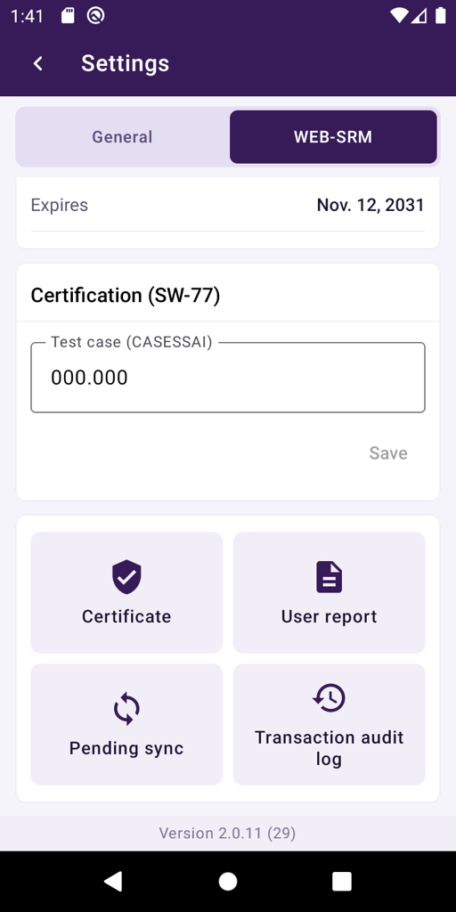

Everything about Revenu Québec on the device is under Home → **Settings** → **WEB-SRM**. The tab appears only when the business uses WEB-SRM.

## Overview

| Field | Shows |
|---|---|
| **Status** | **Certificate installed**, or **No certificate — request one to start billing** |
| **Environment** | The Revenu Québec environment the device is connected to |
| **Device identifier (IDAPPRL)** | Assigned by Revenu Québec |
| **Certificate name (SN)** | The nickname entered when the certificate was requested |
| **Serial number**, **Expires** | The current certificate |

## Certification (SW-77)

**Test case (CASESSAI)** is used only while Revenu Québec certifies the software. Leave it at `000.000`.

## Tools

<Frame caption="The WEB-SRM tab, scrolled to the tools.">
  
</Frame>

| Tile | Use it to |
|---|---|
| **Certificate** | Request, renew, or delete the device certificate. See [Enrol a device](/taliup-pos/web-srm). |
| **User report** | Print the Revenu Québec user report. See [User report](/taliup-pos/web-srm/user-report). |
| **Pending sync** | Send transactions recorded offline. See [Work offline](/taliup-pos/web-srm/offline#send-pending-transactions). |
| **Transaction audit log** | Review, export, or share the device's record of WEB-SRM events. |

## Transaction audit log

The audit log lists every WEB-SRM event the device recorded: the user, the transaction number, the Revenu Québec transaction number, and whether it was recorded offline.

- **Export ZIP** saves the log as a ZIP file on the device.
- **Share ZIP** sends it through the system share menu, for example over Bluetooth.

<Warning>
  The audit log is kept on the device with no automatic expiry. Export it before you clear application data or uninstall Taliup POS.
</Warning>
