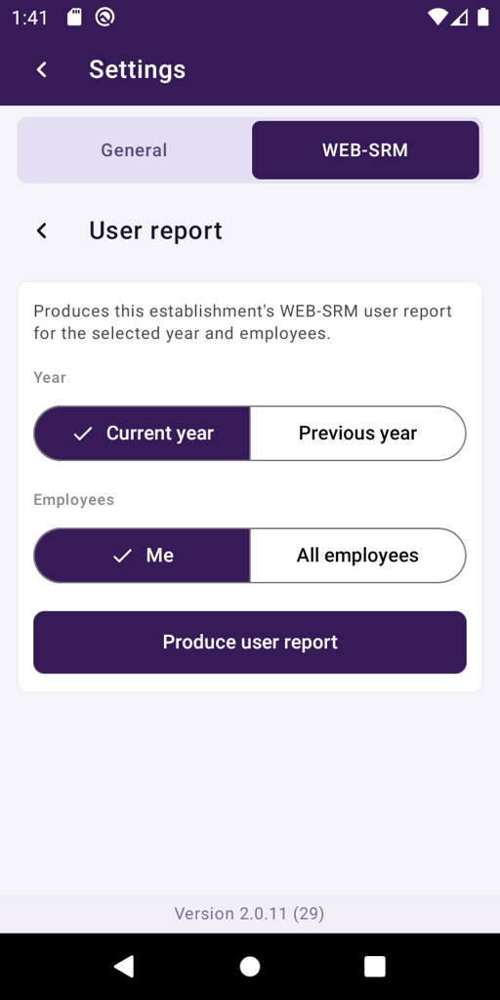

The user report summarizes the sales recorded with Revenu Québec for one employee or the whole business. Revenu Québec produces it; the device prints it.

<Steps>
  <Step title="Open User report">
    Go to **Settings** → **WEB-SRM** → **User report**.
  </Step>
  <Step title="Choose the year">
    Tap **Current year** or **Previous year**.
  </Step>
  <Step title="Choose the employees">
    Tap **Me** for the signed-in employee, or **All employees** for the whole business across all its devices.
  </Step>
  <Step title="Produce the report">
    Tap **Produce user report**. The device must be online.
  </Step>
</Steps>

The report prints with the document number Revenu Québec assigned and a QR code. It counts paid closing receipts, credit notes included, and shows the last document printed.

<Frame caption="User report options.">
  
</Frame>

## Troubleshooting

| Message | What to do |
|---|---|
| **User report failed** | Confirm the device is online, then try again. |
| **User report was produced and archived, but printing failed** | The report exists at Revenu Québec. Fix the printer, then produce it again to print it. |
| **User report was produced and archived, but the printer is out of paper** | Load paper, then produce it again. |
